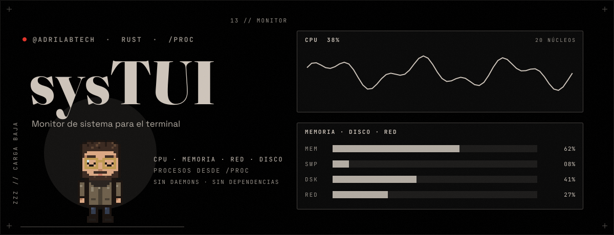

<p align="center"></p>

# sysTUI

Un monitor de sistema pequeño para el terminal, parte de la familia de herramientas de TUI-OS (como fileTUI), escrito en Rust con
[Ratatui](https://ratatui.rs). Lee todo directamente de `/proc`: sin
dependencias de sistema ni daemons.

No pretende competir con btop ni htop. Es la herramienta que uso a diario,
escrita para entender cómo se calcula cada número.

```
  sysTUI   ryoku · activo 3h 17m · carga 8.00 7.94 8.05 · 20 núcleos
┌ CPU  38% ───────────────────────┐┌ MEMORIA · RED · DISCO ───────────────┐
│▁▂▂▃▄▅▅▆▇                        ││MEM  ████████████░░░░ 7.7G/15.3G  50% │
│ 0 ██████░░░░░░░░░░  31%  6 ████ ││SWAP ███████░░░░░░░░░ 3.4G/16.0G  21% │
│ 1 █████████░░░░░░░  45%  7 ████ ││RED   ↓ 1.8K/s  ↑ 300B/s              │
└─────────────────────────────────┘└──────────────────────────────────────┘
```

## Qué muestra

- **CPU**: total con histórico y una barra por núcleo (si no caben, resume
  «+N núcleos más»).
- **Memoria y swap**: usada = `MemTotal − MemAvailable`, igual que `free`.
- **Red** y **disco**: bytes por segundo con histórico. Red suma todas las
  interfaces menos `lo`; disco suma solo discos enteros, no particiones.
- **Procesos**: PID, usuario, estado, CPU %, memoria residente, nombre y
  línea de comandos. Ordenables, filtrables y con terminación segura.

El color solo avisa: hueso en reposo, oro desde el 60 %, bermellón desde el 85 %.

## Teclas

| Tecla | Acción |
| --- | --- |
| `↑` `↓` / `j` `k` | Mover la selección (sigue al proceso aunque cambie el orden) |
| `AvPág` `RePág`, `g` `G` | Saltar una página, ir al primero / último |
| `c` `m` `p` `n` | Ordenar por CPU, memoria, PID, nombre; repetir la tecla invierte |
| `r` | Invertir el orden |
| `/` | Filtrar por nombre, comando, usuario o PID (`Enter` aplica, `Esc` borra) |
| `x` | Terminar el proceso seleccionado: `Enter` = TERM, `9` = KILL, `Esc` cancela |
| `espacio` | Pausar / reanudar |
| `+` `-` | Muestrear más rápido / más lento (0,25 s a 5 s) |
| `?` | Ayuda |
| `q` | Salir |

## Compilar y ejecutar

```sh
cargo build --release
target/release/systui
target/release/systui --snapshot 120x36   # un fotograma como texto, sin TTY
```

Solo Linux (usa `/proc`). Tamaño mínimo del terminal: 60×16.

## Cómo se calcula cada cosa

`/proc` no da porcentajes: da **contadores acumulados**. Cada número que ves
sale de restar dos lecturas.

- **CPU %** = `(Δtotal − Δidle) / Δtotal`, con `idle = idle + iowait`.
- **CPU % de un proceso** = `Δ(utime+stime) / (Δtotal / núcleos)`. Como en
  `top`, 100 % es un núcleo entero, así que en 20 núcleos un proceso puede
  llegar a 2000 %. La frecuencia del reloj (`USER_HZ`) se cancela en el cociente.
- **Red y disco** = `Δbytes / Δsegundos`. Un contador que retrocede (interfaz
  reiniciada) cuenta como cero, nunca como un pico absurdo.
- Los sectores de `/proc/diskstats` son siempre de 512 bytes.

## Seguridad y límites

- Terminar un proceso siempre pide confirmación, y `sysTUI` se niega a señalar
  el PID 1 y a sí mismo. Usa el comando `kill` del sistema: si el proceso es de
  otro usuario, verás el error real del sistema (p. ej. «Operación no permitida»).
- Un proceso que muere entre listar y leer se omite sin error.
- Muestrea en el hilo principal; con ~500 procesos ocupa en torno al 2 % de
  un núcleo y 5 MB de memoria.
- Aún no tiene: vista de árbol, hilos, temperaturas, GPU ni contenedores.
- Probado en una sola máquina (Arch Linux, kernel 7.x). Los contadores de
  `/proc` son los mismos en cualquier Linux, pero no lo he verificado en otros.

## Arquitectura

| Módulo | Responsabilidad |
| --- | --- |
| `procfs` | Parsers puros de `/proc` y la lectura de una instantánea |
| `metrics` | Dos instantáneas → porcentajes y tasas; formato de tamaños |
| `state` | Estado, orden, filtro, selección, diálogos y teclas (sin dibujar) |
| `ui` | Todo el dibujo con Ratatui (no toca `/proc`) |

Tests: `cargo test`.

## Licencia

MIT. Ver [LICENSE](LICENSE).
